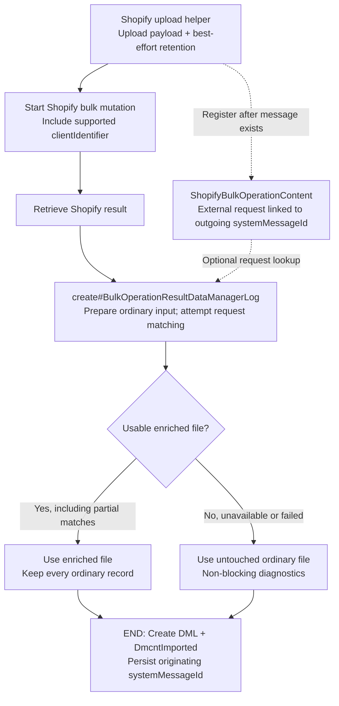

# Shopify bulk request retention and result correlation

Implementation spec · September 13, 2026 · Not implemented

## Scope

Implement in the Shopify connector:

- One entity: `ShopifyBulkOperationContent`, plus purpose enums and a lookup index.
- Two shared service entry points: `upload#BulkOperationFile` and `create#BulkOperationResultDataManagerLog`.
- Updates to adopted producers, result consumers, transformation adapters, and bulk-mutation request construction.

Start with product-location activation. End the flow when the Data Manager log (DML) and its input attachment are created. Reuse existing System Message and MDM services; no framework/schema changes to System Message, MDM scheduler changes, or per-record import-service changes.

**Retention and enrichment are best-effort. Their failures must never prevent an otherwise valid Shopify submission or result-to-DML handoff.**

## Entity and file storage

Define `co.hotwax.shopify.ShopifyBulkOperationContent` in the connector.

| Field | Definition |
| --- | --- |
| `bulkOperationContentId` | Primary key |
| `systemMessageId` | Required relationship to the originating outgoing System Message |
| `purposeEnumId` | External request or External response |
| `contentLocation` | Full Moqui resource location |
| `fileName` | Display filename |
| `createdDate` | Creation timestamp |

Add connector-owned purpose enumeration values and an index on `(systemMessageId, purposeEnumId)`. Store files in content storage, not database blobs. System Message remains the authority for status and Shopify's operation GID in `remoteMessageId`.

Use the existing content-root resolver, `MaargUtil.toContentLocation`, with a connector folder:

```text
<content-root>/shopify/bulk-operations/<artifact-id>/request.jsonl
<content-root>/shopify/bulk-operations/<artifact-id>/response.jsonl
```

The configured root defaults to `runtime://datamanager`. Verify persistent storage and access from the nodes that submit and process results. Do not assume a runtime directory survives pod replacement.

Use an immutable artifact ID allocated before upload. Preserve the exact rendered text passed to the HTTP file part, including JSONL line boundaries. Retain request and response files for the agreed operational retention period; cleanup must respect linked MDM records. Confirm the period and storage configuration before rollout.

Do not overwrite an earlier request on retry. Reuse a retained artifact only for the identical submitted payload; a changed payload requires a new submission identity. An attachment record alone does not prove Shopify accepted the upload or operation.

## Service 1: upload and retain the request

Proposed entry point: `co.hotwax.shopify.graphQL.ShopifyBulkImportServices.upload#BulkOperationFile`.

Reuse the existing staged-upload and `upload#JsonlFileToShopify` implementation. Do not duplicate HTTP upload logic or render the upload and retained copy independently.

**Inputs:** source file location/name, staged-upload context, and originating System Message ID when already available.

**Outputs:** existing `stagedUploadPath`, retained-file descriptor when available, and non-blocking retention diagnostics.

Behavior:

1. Obtain the final text that will be passed to `RestClient.addFilePart`.
2. Attempt to save that payload under the connector content folder.
3. Upload using the existing Shopify path, preserving its normal success/failure behavior.
4. Register the retained file as External request against the outgoing message. If the message has not been created yet, return the descriptor for registration immediately after queuing.
5. On optional retention/registration failure, continue submission and report a diagnostic.

**Activation ordering:** today the producer generates and uploads the file, queues a System Message containing Shopify's staged path, then deletes the source file. Keep that working order. Update the producer to register returned content against the new `systemMessageId` using entity-auto creation and to avoid deleting the retained artifact. The helper may register directly when its caller already has the outgoing message. This association cannot be inferred by Moqui's generic sender.

Default retention on migrated Shopify bulk-file paths. No generic System Message retention flag is needed.

## Service 2: correlate the result and create the DML

Proposed entry point: `co.hotwax.shopify.system.ShopifySystemMessageServices.create#BulkOperationResultDataManagerLog`.

**Inputs:**

- Originating outgoing `systemMessageId`, supplied by the existing completion context.
- Downloaded Shopify result location and file metadata.
- Existing MDM `configId` and processing parameters, including shop context.
- The operation's existing transformation adapter/context.

**Outputs:** created `logId`, selected input-file metadata, and enrichment diagnostics.

Behavior:

1. Preserve the existing transformation path to produce an ordinary MDM-ready file. Keep it untouched as the fallback.
2. Attempt to register the raw result as External response.
3. Find the message's External request content and match Shopify's zero-based `__lineNumber` to that exact request file.
4. Carry source-line context through the operation adapter. Write a separate enriched candidate without dropping, reordering or changing the ordinary business records.
5. Select the completed candidate when usable; otherwise select the ordinary file.
6. Call existing `co.hotwax.util.UtilityServices.create#DataManagerLog` with `systemMessageId`, configuration/parameters, and the selected file as `DmcntImported`. Create the pending log and imported attachment together.

The persisted `DataManagerLog.systemMessageId` must identify the outgoing request, not a webhook or incoming result message. In legacy chains, resolve that association using the existing message relationship; carry it independently of optional content lookup. Child/reprocessing logs must preserve it through existing lineage behavior. Multiple DMLs may reference one message.

### Matching and failure behavior

| Condition | Required behavior |
| --- | --- |
| All or some rows match | Enrich matched rows; preserve unmatched rows unchanged |
| No request file, ambiguous attachment, missing/invalid line reference, or zero matches | Continue with ordinary records; report unavailable context |
| Lookup, parsing, candidate-write failure or enrichment timeout | Use the untouched ordinary MDM-ready file |
| Unsupported or unverified consumer compatibility | Skip enrichment; create the DML normally |
| Existing download, required transformation, storage or DML-creation failure | Preserve existing error handling; do not report false success |

Match using **outgoing message + exact request artifact + original line reference**, never the result-file position or a fresh product query. One request line may contain several items; do not infer a specific nested item without supporting error-path evidence.

Bound enrichment time/memory and batch line lookups. Do not repeatedly scan the request for every error. Optional failures must not leave Moqui error messages or a rollback-only transaction that prevents DML creation; isolate them without clearing unrelated errors.

Bulk queries have no uploaded per-row input file. They can use the normal handoff, but must not fabricate request-line matches.

### Import-service compatibility

Add request context as a separate, reserved top-level metadata field; preserve all existing business-field paths. Proposed record metadata:

```json
{
  "_externalRequest": {
    "bulkOperationContentId": "content-id",
    "lineNumber": 0,
    "record": {}
  }
}
```

Here `record` contains the original submitted row. Do not inject this metadata into the file uploaded to Shopify.

The MDM JSON loader retains the input record when writing errors. Moqui's default validated-service path strips undeclared parameters from the service call. Services using `validate="false"` receive extra fields, and pre-validation hooks may also see them.

Verify compatibility per adopted path, including metadata/default collisions and chunking. Activation and inventory-reset imports use default validation; product sync explicitly disables it. Validation-disabled services are not automatically broken, but must be checked. Unsupported paths fall back without consumer changes. Never retry a business-service execution to test whether enrichment caused its failure.

## Shopify client identifier

For supported bulk mutations, submit:

```text
clientIdentifier = systemMessage://<stable-oms-instance-key>/<systemMessageId>
```

Example: `systemMessage://rails-prod/110220`. Use a stable configured environment/tenant identity, not a pod name. This is our correlation URI, not a Shopify-issued GID.

Pass it from `send#BulkMutationSystemMessage` through `run#BulkOperationMutation` into the mutation request using correctly serialized GraphQL variables. Continue storing Shopify's returned GID in `SystemMessage.remoteMessageId`.

The checked API 2026-01 accepts this argument on `bulkOperationRunMutation`, not `bulkOperationRunQuery`. It does not document a corresponding readable operation field or list filter. Verify configured-version support before enabling; do not promise reverse lookup, webhook echo, or idempotency. Never blindly retry an ambiguous submission using the tag.

## Flow



## Caller changes

| Existing code | Update |
| --- | --- |
| `sync#ShopifyProductFacilityActivation` | Call upload helper; register returned content after queuing; preserve retained file |
| `consume#ShopifyProductLocationActivationResult` | Resolve originating message; call result-to-DML helper with existing config and parameters |
| `transformShopifyProductLocationActivationResult.groovy` | Preserve optional source-line/request context in confirmation and error records |
| `send#BulkMutationSystemMessage`, `run#BulkOperationMutation`, adopted mutation templates | Pass `clientIdentifier` |
| Other adopted upload/result callers | Use the same helpers while retaining their existing adapters and MDM configurations |

The activation transformer currently creates confirmation records without a source-line reference; updating only the producer and consumer is insufficient. Migrate other flows individually, including the legacy `consume#GraphQLBulkImportFeed` path.

Do not change Moqui `send#ProducedSystemMessage`, its queue service, or Shopify admission scheduling for this feature. File upload happens before the outgoing mutation reaches those send services.

## Required checks

- Retained payload matches the uploaded payload; lookup uses the correct message and artifact.
- Missing content, zero/partial matches, shuffled result lines, timeouts and enrichment-write failures still hand off every ordinary record.
- Ordinary and enriched paths produce identical business-service inputs/behavior; error output retains metadata where supported.
- Every created DML carries the originating `systemMessageId`, including legacy result chains; existing retries/child logs preserve the association.
- Optional failures cannot contaminate submission or DML transactions.
- Repeated result handling preserves existing duplicate-handling behavior; the change does not cause duplicate imports.
- Client identifiers distinguish instances and use supported API arguments.
- Storage survives worker replacement and is readable by result processors; cleanup respects retention.
- Validate against representative non-production activation success and failure results. Do not run production mutations for testing.

Before implementation, confirm the deployed component/API versions, active overlapping connector changes, stable instance identifier, storage/retention configuration and consumer compatibility. Source inspection establishes contracts, not production readiness.

## Later work

Error cards can display External request and links using this metadata. Product/facility rankings should distinguish failure occurrences from distinct affected pairs and retain unresolved records. UI/rankings, bulk-operation capacity orchestration and broad migration are separate from this implementation.

## Source references

Inspected September 12–13, 2026. Connector links pin `origin/main` at `9d5a0405`; local framework/MDM files are working-tree evidence.

- [Activation producer, consumer and import service](https://github.com/hotwax/mantle-shopify-connector/blob/9d5a0405f7e96ab4ed262542d68c9fce8e6ba847/service/co/hotwax/sob/product/InventoryServices.xml#L280), [file generator](https://github.com/hotwax/mantle-shopify-connector/blob/9d5a0405f7e96ab4ed262542d68c9fce8e6ba847/script/co/hotwax/sob/product/generateShopifyProductLocationActivationFeed.groovy), [result transformer](https://github.com/hotwax/mantle-shopify-connector/blob/9d5a0405f7e96ab4ed262542d68c9fce8e6ba847/script/co/hotwax/sob/product/transformShopifyProductLocationActivationResult.groovy).
- [Existing upload and mutation helpers](https://github.com/hotwax/mantle-shopify-connector/blob/9d5a0405f7e96ab4ed262542d68c9fce8e6ba847/service/co/hotwax/shopify/graphQL/ShopifyBulkImportServices.xml#L46), [connector message services](https://github.com/hotwax/mantle-shopify-connector/blob/9d5a0405f7e96ab4ed262542d68c9fce8e6ba847/service/co/hotwax/shopify/system/ShopifySystemMessageServices.xml#L117), [product-sync validation setting](https://github.com/hotwax/mantle-shopify-connector/blob/9d5a0405f7e96ab4ed262542d68c9fce8e6ba847/service/co/hotwax/sob/product/ProductServices.xml#L77).
- [Existing MDM creation service](/Users/adityapatel/Documents/GitHub/moqui/maarg-oms/moqui-framework/runtime/component/maarg-util/service/co/hotwax/util/UtilityServices.xml:226), [content-root resolver](/Users/adityapatel/Documents/GitHub/moqui/maarg-oms/moqui-framework/runtime/component/maarg-util/src/main/groovy/co/hotwax/util/MaargUtil.groovy:289).
- [MDM JSON record/error handling](/Users/adityapatel/Documents/GitHub/moqui/maarg-oms/moqui-framework/runtime/component/maarg-util/src/main/java/co/hotwax/datamanager/MaargDataLoaderImpl.java:629), [Moqui parameter cleaning](/Users/adityapatel/Documents/GitHub/moqui/maarg-oms/moqui-framework/framework/src/main/groovy/org/moqui/impl/service/ServiceDefinition.java:379), [pre-validation hooks](/Users/adityapatel/Documents/GitHub/moqui/maarg-oms/moqui-framework/framework/src/main/groovy/org/moqui/impl/service/ServiceCallSyncImpl.java:173).
- Shopify: [bulk result/line references](https://shopify.dev/docs/api/usage/bulk-operations/imports), [mutation clientIdentifier](https://shopify.dev/docs/api/admin-graphql/2026-01/mutations/bulkOperationRunMutation), [query arguments](https://shopify.dev/docs/api/admin-graphql/2026-01/mutations/bulkOperationRunQuery), [operation fields](https://shopify.dev/docs/api/admin-graphql/2026-01/objects/BulkOperation), [operation filters](https://shopify.dev/docs/api/admin-graphql/2026-01/queries/bulkOperations).
